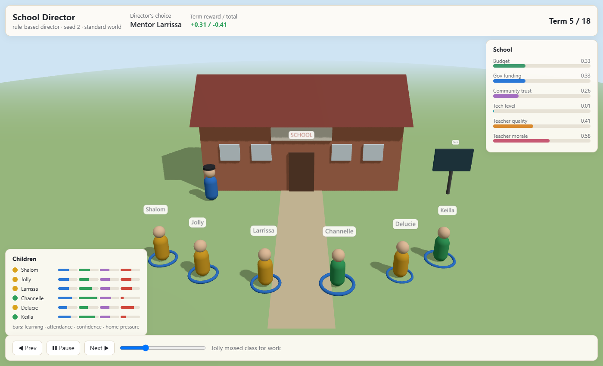

# School Director: Mission-Based Reinforcement Learning

**Mission:** quality education for children in underserved communities through qualified
teachers, mentorship, family support and government backing.

An RL agent plays the director of one school. For 18 terms (6 years) it makes one decision
per term to keep six children in school, learning and confident. DQN, REINFORCE, PPO and A2C
are trained with **TorchRL** on the same environment and compared.

| Pygame GUI (live) | three.js 3D replay |
|---|---|
|  |  |

## Run it (uv only)

```bash
git clone https://github.com/amaliza-shal/Amaliza_shalom_rl_Summative.git
cd Amaliza_shalom_rl_Summative
uv sync
uv run main.py
```

`uv run main.py` plays the best agent (PPO) with the GUI and prints every term in the
terminal. `play.py` does the same. Useful options:

```bash
uv run main.py --seed 4 --delay 9 --scale 0.62 --view3d   # demo episode from the video
uv run main.py --algo dqn                                  # dqn, reinforce, ppo, a2c, rule, random
uv run main.py --scenario hard                             # harder world
uv run main.py --no-window                                 # terminal only
```

## Environment (`environment/custom_env.py`)

- **Agent:** the school director (Gymnasium env `SchoolDirector-v0`).
- **Actions:** `Discrete(19)`: hire or train teachers, buy technology, reach remote areas,
  engage the community, lobby the government, save money, mentor a child (x6), support a
  child's family (x6).
- **Observation:** `Box(0, 1, (32,))`: learning, attendance, confidence and home pressure for
  each child, plus budget, teachers, teacher quality and morale, trust, technology, funding and
  term.
- **Reward:** gains in learning, confidence and trust, plus attendance; penalties for
  dropouts, teacher quits, unaffordable actions and unfair gaps; a bonus of up to +20 at term 18
  for children who *finish strong* (learning >= 0.65 and confidence >= 0.55).
- **Start / end:** small budget, 2 teachers, low trust. Ends at term 18, budget collapse, all
  teachers quitting, or 4 dropouts.
- **Visualisation:** Pygame GUI (`environment/rendering.py`) and three.js replay
  (`environment/viewer3d.html`).

## Training (`training/`)

```bash
uv run python -m training.dqn_training --run-id my_dqn
uv run python -m training.pg_training --algo ppo --run-id my_ppo
uv run python -m training.sweeps --phase sweep --algo all --workers 4   # runs 1-10 per algorithm
uv run python -m training.sweeps --phase combo --algo all               # runs 11-12
uv run python -m training.sweeps --phase seeds --algo all               # best config x 3 seeds
uv run python -m training.plots                                          # figures and leaderboard
```

Each algorithm has 12 hyperparameter runs (`logs/<algo>/sweep_results.csv`). The best models
are in `models/dqn/` and `models/pg/`.

## Results

| Agent | Mean reward (3 seeds) | Finish strong | Unseen states | Harder world |
|---|---|---|---|---|
| Random | -4.18 | 8% | -1.97 | -2.51 |
| Rule-based | 12.94 | 51% | 13.16 | 5.73 |
| DQN | 19.32 ± 1.89 | 67% | 19.39 | 9.72 |
| REINFORCE | 18.77 ± 0.89 | 65% | 18.86 | 11.79 |
| **PPO** | **21.29 ± 0.70** | **78%** | **21.16** | **13.29** |
| A2C | 17.75 ± 0.74 | 59% | 17.86 | 11.53 |

Figures are in `assets/`, and the full report is in `report/`.

## Repository layout

```
├── pyproject.toml, uv.lock, README.md
├── main.py, play.py          # run a trained agent
├── environment/              # custom_env.py, rendering.py, viewer3d.html
├── training/                 # dqn_training.py, pg_training.py, sweeps, plots, baselines, predict
├── models/                   # dqn/, pg/ (best models)
├── logs/                     # sweep results, configs, training curves
├── assets/                   # figures and screenshots
├── report/                   # summative report (PDF and Word)
└── tests/                    # uv run pytest -q
```
