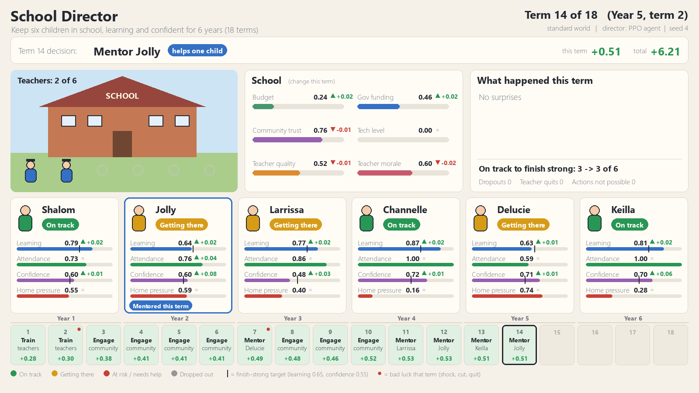
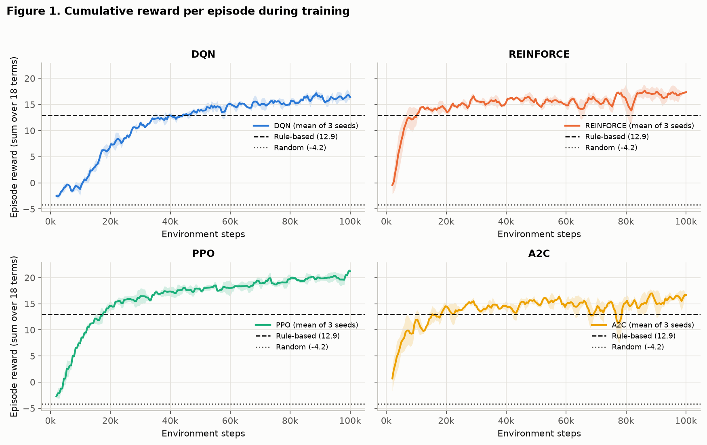
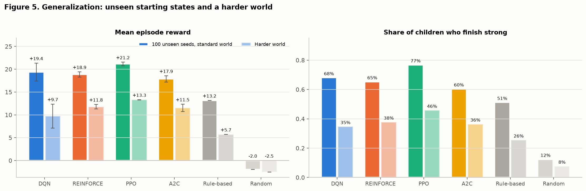
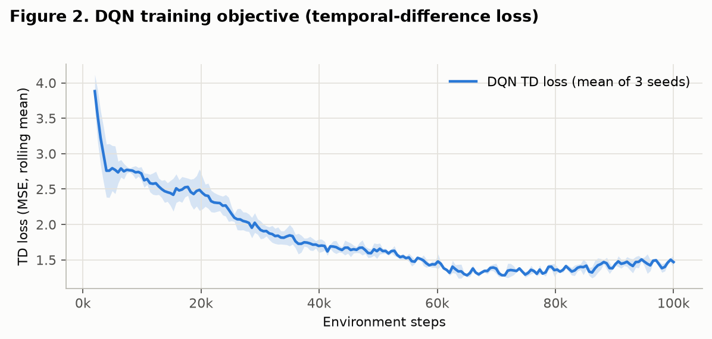
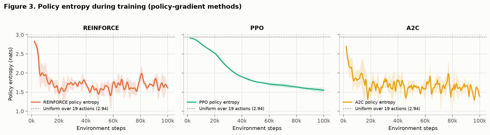
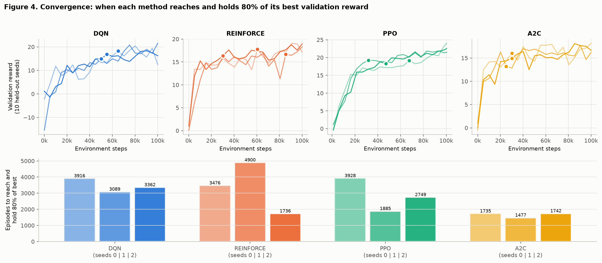
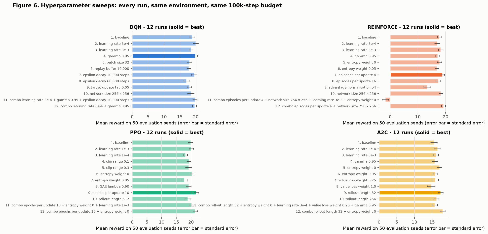

# School Director: Mission-Based Reinforcement Learning

**Mission:** give children in underserved communities a quality education through
qualified teachers, mentorship, family support and government backing, so they grow
into confident, capable people.

**The RL problem:** an agent plays the director of one school in an underserved
community. It looks after six children for 18 school terms (6 years) and makes one
decision per term. Success means that at the end, children are still in school,
learning well (learning ≥ 0.65) and confident (confidence ≥ 0.55). We call this
*finishing strong*.

Four agents are trained with **TorchRL** on the same environment and compared:
DQN (value-based), REINFORCE, PPO and A2C (policy gradient).

| Pygame (live GUI) | three.js / WebGL (3D replay) |
|---|---|
|  |  |

---

## Quick start (uv only)

```bash
git clone <this repo>
cd <repo folder>
uv sync                 # creates the environment from pyproject.toml + uv.lock
uv run main.py          # runs the best trained agent with the Pygame GUI
```

No manual `pip install` and no manual virtual environment. `uv` installs Python 3.12
automatically if needed.

### Play any trained agent (`main.py` is the play script)

```bash
uv run main.py --algo ppo                    # GUI + one line per term in the terminal
uv run main.py --algo dqn --seed 7 --delay 3 # slower, another starting state
uv run main.py --algo rule                   # rule-based baseline
uv run main.py --algo ppo --scenario hard    # the harder world
uv run main.py --no-window                   # best agent, terminal only
uv run main.py --algo dqn --view3d           # also open a three.js 3D replay in the browser
```

**Two views of the same environment.** The Pygame window (`environment/rendering.py`)
runs live while the agent plays. The 3D view (`environment/viewer3d.html`, three.js /
WebGL) replays the saved episode JSON in the browser: a 3D school with one figure
per teacher, the six children coloured green / yellow / red by how they are doing,
dropouts walking away, a rotatable camera and play / pause / step controls.

Options: `--algo {best,dqn,reinforce,ppo,a2c,rule,random}`, `--seed`, `--delay`
(seconds per term), `--scenario {standard,hard}`, `--episodes`, `--gif <path>`.
Every episode is saved as JSON in `logs/episodes/`.

---

## The environment (`environment/custom_env.py`)

A Gymnasium environment, `SchoolEnv`, registered as `SchoolDirector-v0`.

### The six children

| Child | Story | Starts with |
|---|---|---|
| Shalom | Walks two hours each way; sharp but tired and late | High distance, low attendance |
| Jolly | Works after school; misses class when work picks up | High home pressure |
| Larrissa | Quiet, rarely speaks, needs a mentor | Very low confidence |
| Channelle | Bright, bored without technology | High learning, learns faster with tech |
| Delucie | Lives with a grandparent; very little money | Very high home pressure |
| Keilla | Steady and easy to overlook; slips if ignored for 4+ terms | Good attendance |

Each reset adds ±0.05 noise to every starting value, so the agent cannot memorise one story.

### Actions: `Discrete(19)`

| Id | Action | Cost | Effect (and delay) |
|---|---|---|---|
| 0 | Hire a teacher | 0.20 + salary | One more teacher next term; new teacher quality 0.30 lowers the average |
| 1 | Train teachers | 0.10 | Quality +0.15 × (1 − quality) in 2 terms; morale +0.08 next term |
| 2 | Buy technology | 0.20 | Tech +0.15 next term, +0.10 the term after; wears down 0.02/term |
| 3 | Reach remote areas | 0.10 | Every child's distance −0.05 for each of the next 3 terms |
| 4 | Engage the community | 0.03 | Trust +0.025 for each of the next 3 terms |
| 5 | Lobby the government | 0.03 | 55–80% chance of funding +0.08 in 2 terms (higher when results improve) |
| 6 | Save money | 0 | Nothing is spent; morale −0.01, trust −0.005 |
| 7–12 | Mentor *child* | 0.04 | Mentor boost +1.0, fading ×0.6 per term (confidence over 2–3 terms) |
| 13–18 | Support *child*'s family | 0.08 | Poverty −0.06 (lasting) + relief that halves each term |

If the school cannot pay for an action, nothing happens and the reward is −1.

### Observation: `Box(0, 1, (32,), float32)`

For each child, in order: `[learning, attendance, confidence, home_pressure]`
(24 numbers). Then 8 school numbers: `[budget, teachers/6, teacher_quality,
teacher_morale, community_trust, tech_level, gov_funding, term/18]`.
All are updated once per term. The report lists the real-world source of each one
(grading records, digital register, staff survey, ministry grant portal, ...).

### Reward (weights locked before the experiments)

```
R_t = 10·Δ(avg learning) + 5·Δ(avg confidence) + 0.2·(avg attendance) + 2·Δ(trust)
      − 5·(new dropouts) − 2·(teacher quits) − 1·[max learning − min learning > 0.4]
      − 1·[action could not be paid]
Budget collapse: −10 and the episode ends.
Term 18: +20 × (children who finish strong) / 6
```

### Start state and episode end

Start: budget 0.40, 2 teachers, quality 0.40, morale 0.60, trust 0.30, tech 0.10,
government funding 0.30 (all ±0.05).

The episode ends when term 18 is reached, the budget cannot pay the teachers
(collapse), all teachers have quit, or 4 or more children have dropped out.
A child drops out when attendance and confidence are both below 0.25 for 2 terms in a row.

### Random events (seeded)

Funding cut (10% per term, funding × 0.7); a teacher leaves (30% per term if morale
< 0.3, else 2%); a family shock (5% per child per term, poverty +0.33). The
*harder world* (`--scenario hard`) uses a 25% funding-cut chance, +0.15 poverty for
every child and only 1 starting teacher.

---

## Training (TorchRL)

All four algorithms train on the same TorchRL wrapper
(`GymWrapper` + `StepCounter` + `RewardSum`, see `training/common.py`) with the
same 100,000-step budget.

| Algorithm | File | TorchRL pieces |
|---|---|---|
| DQN | `training/dqn_training.py` | `QValueActor`, `EGreedyModule`, `TensorDictReplayBuffer`, `DQNLoss`, `SoftUpdate` |
| REINFORCE | `training/pg_training.py` | `ProbabilisticActor`, `ReinforceLoss` (Monte Carlo returns, no learned baseline) |
| PPO | `training/pg_training.py` | `ClipPPOLoss`, `GAE`, `Collector` |
| A2C | `training/pg_training.py` | `A2CLoss`, `GAE`, `Collector` |

```bash
# one run
uv run python -m training.dqn_training --run-id my_dqn --steps 100000
uv run python -m training.pg_training --algo ppo --run-id my_ppo --config '{"clip": 0.1}'

# full experiment pipeline (resumable: finished runs are skipped)
uv run python -m training.sweeps --phase sweep --algo all --workers 4   # runs 1-10 per algorithm
uv run python -m training.sweeps --phase combo --algo all               # runs 11-12 (combined best settings)
uv run python -m training.sweeps --phase seeds --algo all               # best config x seeds 0,1,2 -> models/
uv run python -m training.plots                                          # figures, generalization, leaderboard
uv run python -m training.baselines                                      # random / rule-based baselines
```

**Evaluation.** Every run keeps the checkpoint with the best score on 10 validation
seeds (2000–2009), then is scored on 50 fixed evaluation seeds (1000–1049).
Generalization uses 100 unseen seeds (50000–50099) and the harder world. DQN acts
greedily on its Q-values; the policy-gradient agents act by sampling from their
learned policy (a seeded generator makes this reproducible). Greedy scores of the
policy-gradient agents are also logged (`greedy_mean_reward` in each `summary.json`).

---

## Results

Each algorithm ran 12 configurations (10 single changes + 2 combinations, one
training seed each). The best configuration was re-trained with seeds 0, 1 and 2.
Full tables: `logs/{dqn,reinforce,ppo,a2c}/sweep_results.md`, `logs/results/`.

| Agent | Best run | Mean reward (50 eval seeds, 3 training seeds) | Finish strong | 100 unseen seeds | Harder world |
|---|---|---|---|---|---|
| Random | - | -4.18 | 8% | -1.97 | -2.51 |
| Rule-based | - | 12.94 | 51% | 13.16 | 5.73 |
| DQN | 4 (gamma 0.95) | 19.32 ± 1.89 | 67% | 19.39 ± 1.96 | 9.72 |
| REINFORCE | 7 (4 episodes / update) | 18.77 ± 0.89 | 65% | 18.86 ± 0.56 | 11.79 |
| **PPO** | **9 (10 epochs / update)** | **21.29 ± 0.70** | **78%** | **21.16 ± 0.39** | **13.29** |
| A2C | 9 (32-step rollouts) | 17.75 ± 0.74 | 59% | 17.86 ± 0.69 | 11.53 |

**PPO is the best agent on average and the most robust.** All three PPO models
beat every other model in the harder world. In the normal world its lead over DQN
(1.77) is smaller than DQN's seed-to-seed spread, so there it is ahead but not
decisively. A2C converges fastest (about 28,500 steps to 80% of its best), but to
the lowest score. `uv run main.py` plays the best agent (`models/best_agent.json`).

| | |
|---|---|
|  |  |
|  |  |
|  |  |

---

## Integration: JSON in, action out

```python
from environment import SchoolEnv
from training.predict import predict, predict_proba

env = SchoolEnv()
env.reset(seed=0)
state_json = env.get_state_json()   # full state as JSON (school, six children, events)
predict(state_json)                 # -> e.g. "Mentor Larrissa"
predict_proba(state_json)           # -> probability of each of the 19 actions
```

A web dashboard or a Flutter app can send this JSON and display the recommended
action. `obs_from_state()` rebuilds the 32-number observation from the JSON, so the
app never needs to know the observation layout. `main.py` writes every episode as
JSON (per-term state, action, reward, events) to `logs/episodes/`.

---

## Repository layout

```
project_root/
├── pyproject.toml          # dependencies (uv)
├── uv.lock                 # exact locked versions
├── README.md
├── main.py                 # play any trained agent with the GUI (default: the best one)
│
├── environment/
│   ├── __init__.py
│   ├── custom_env.py       # SchoolEnv (Gymnasium API)
│   ├── rendering.py        # Pygame view + three.js replay export
│   └── viewer3d.html       # three.js (WebGL) 3D replay page
│
├── training/
│   ├── __init__.py
│   ├── dqn_training.py     # DQN (TorchRL)
│   ├── pg_training.py      # REINFORCE, PPO, A2C (TorchRL)
│   ├── common.py           # shared TorchRL env wrapper, evaluation, logging
│   ├── sweeps.py           # 10+ hyperparameter runs per algorithm
│   ├── baselines.py        # random and rule-based agents
│   ├── plots.py            # figures, generalization, leaderboard
│   └── predict.py          # predict(state_json) -> action name
│
├── models/
│   ├── best_agent.json     # which algorithm won (read by main.py and predict.py)
│   ├── dqn/                # best DQN policy
│   └── pg/                 # best REINFORCE, PPO and A2C policies
│
├── logs/                   # per-run configs, training/eval CSVs, result tables, episode JSON
├── assets/                 # screenshots and figures
└── tests/                  # environment checks (uv run pytest)
```

## Tests

```bash
uv run pytest -q
```

Checks: Gymnasium `check_env`; same seed → same trajectory; observations in [0, 1]
with no NaN; every terminal condition is reachable; the JSON state round-trips; the
hard world is harder; a scripted balanced plan scores more than the rule-based agent,
which scores more than random play.

## Limits

This is a simulation. All numbers sit on a 0–1 scale and come from simple update
rules chosen by us; it shows the trade-offs in the mission, not a forecast for a
real school. The sweep used one training seed per run; only the best configuration
of each algorithm was re-trained with three seeds.
